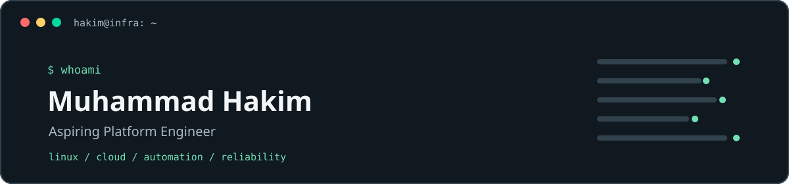

  

  <strong>Platform Engineering · Cloud Infrastructure · Systems Reliability</strong>
   
  Diploma in Information Technology student at Universiti Tun Hussein Onn Malaysia (UTHM)

  <code>Build → Deploy → Break → Observe → Fix → Document → Improve</code>

I am a Diploma in Information Technology student at Universiti Tun Hussein Onn Malaysia (UTHM), with a primary interest in platform engineering and related areas of cloud infrastructure, automation, and systems reliability.

## Selected engineering projects

### PersonalHub — personal productivity platform

A privately hosted, single-owner application for tasks, assignments, projects, notes, and planning. PersonalHub keeps domain rules in application services and exposes a versioned API with scoped, expiring tokens for trusted clients. Its v3.2 implementation includes a manual, one-way Google Calendar projection.

- Next.js, TypeScript, Prisma, and PostgreSQL
- Owner-authenticated browser app and normalized Today, Upcoming, capture, and task API operations
- Manual, one-way Google Calendar projection for eligible dated tasks and assignments; no background or inbound synchronization
- Docker-based runtime, Terraform/Ansible infrastructure workflows, backup and restore documentation, and isolated automated test workflows

[PersonalHub repository](https://github.com/Xaknm-Hakim/PersonalHub) · [API contract](https://github.com/Xaknm-Hakim/PersonalHub/blob/main/docs/API.md) · [Google Calendar design](https://github.com/Xaknm-Hakim/PersonalHub/blob/main/docs/GOOGLE-CALENDAR.md)

### StudexHub — academic management application

A full-stack academic app for semesters, courses, assignments, schedules, GPA/CGPA, and notifications, paired with a self-hosted Linux deployment.

- Next.js, TypeScript, PostgreSQL, Prisma, and Docker Compose
- Separate Monitoring and mini-control-plane projects extend the story into service health, alerting, and gated operations

[StudexHub](https://github.com/Xaknm-Hakim/StudexHub) · [Monitoring](https://github.com/Xaknm-Hakim/Monitoring) · [Mini control plane](https://github.com/Xaknm-Hakim/mini-control-plane)

### Enterprise campus network — simulated design

A Cisco Packet Tracer campus-network design exploring a three-tier layout, segmentation, redundant routing, central services, and documented failure scenarios. This is a simulation, not an operating production network.

- VLANs, OSPF, HSRP, DHCP relay, ACLs, and VoIP
- Design report includes connectivity, failover, and troubleshooting checks

[Network design and report](https://github.com/Xaknm-Hakim/Network-Campus-Topology)

## Technical stack

These technologies are represented through project work; this is a developing toolkit, not a claim of specialist-level experience.

**Linux & Infrastructure** 
`Linux` `systemd` `Docker` `Docker Compose` `Nginx` `SSH` `KVM/libvirt`

**Cloud & IaC** 
`AWS` `Terraform` `Ansible` `Cloudflare Tunnel` — actively developing cloud architecture depth

**Containers & Platform** 
`Docker` `Docker Compose` `Nginx` `PostgreSQL`

**Automation & CI/CD** 
`Python` `Bash` `GitHub Actions`

**Observability** 
`Prometheus` `Grafana` `Alertmanager` `Blackbox Exporter`

**Networking** 
`VLANs` `OSPF` `HSRP` `ACLs` `DHCP`

**Programming & Databases** 
`Python` `TypeScript / JavaScript` `SQL` `PostgreSQL` `Prisma`

## Current engineering focus

These are active learning and home-lab goals, not claims of production Kubernetes or cloud experience:

- Cloud architecture and reproducible infrastructure with Terraform
- KVM/libvirt home lab and Linux system administration
- AWS architecture and cloud networking fundamentals
- Infrastructure automation, deployment, observability, and recovery workflows
- Reliability engineering foundations

## Contact

[LinkedIn](https://www.linkedin.com/in/muhammad-hakim-zaaba) · [Email](mailto:hakimz.7117@gmail.com)
